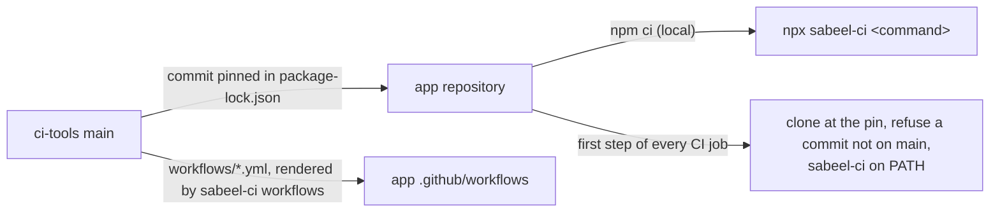

# ci-tools

The CI, release and device-test tooling of the Sabeel Institute apps (LMS,
Kanban, Time Tracker): one copy, which each app pins to a commit. What differs
between the apps is said once, in each app's `ci-tools.json`.



## In an app

```sh
npm install --save-dev github:Sabeel-Institute/ci-tools#<commit>
npx sabeel-ci workflows        # render the shared workflows into .github/workflows/
npx sabeel-ci check-app        # what ci-tools assumes of the app
npx sabeel-ci <command> [args] # any command below
```

`sabeel-ci` runs from anywhere inside the app; each command works at the app's
root, the directory holding `ci-tools.json`.

| Command | What it does |
|---|---|
| `check-app` | The app meets what these tools assume: `ci-tools.json`, the rendered workflows, `.gitignore` covering the files CI writes from secrets and the build stamp, identifiers the premerge fixtures accept, a deploy-log entry for the app's version, `functions/package-lock.json` in step with its manifest |
| `workflows [--check]` | Render `workflows/*.yml` into `.github/workflows/`, or fail on any difference |
| `build-info` | Stamp `app/src/build-info.ts` with `app.json`'s version and the commit, `+` when the tree is dirty, for the sign-in label |
| `build-web [--source-maps]` | The web export: version check, stamp, `expo export --clear` into `app/dist-web`, which must carry the stamp |
| `build-aab [--check]` | The signed Play bundle: version check, a deploy-log entry for the version, the native Sentry DSN in `app/.env.local`, stamp, `gradlew bundleRelease`, then no unsigned or debug-signed bundle; `--check` stops before the build |
| `check-version` | `app.json`'s version is store-legal, and Android's versionName and versionCode follow from it |
| `deploy-notes <version> [--title]` | A release's notes, from the deploy log in `docs/PHASE_STATUS.md` |
| `check-text-sources` | No tracked source file holds a control byte that makes tools treat it as binary |
| `preflight-metro` | Refuse to start Metro while another project's Metro holds port 8081 |
| `ci-platform <task>` | Signed release builds, through `build-aab` and `build-web`, and their provenance: `prepare-android`, `prepare-web`, `android`, `web`, `resolve-build`, `resolve-android-build`, `deploy-config`, `validate-auth` |
| `ci-play verify\|release` | Check a downloaded Play bundle, then check Play access or publish to internal testing |
| `ci-hosting-smoke [--preflight]` | Read-only checks of a Hosting release, before and after publishing |
| `ci-functions require-ci\|plan\|verify` | Guards around a Cloud Functions deploy |
| `ci-premerge <task>` | Pull-request builds with no secrets: `sdk`, `backend`, `prepare`, `android`, `ios` |
| `ci-android-sdk` | The Android SDK packages Gradle needs, with retries |
| `ci-avd` | Boot an emulator on a GitHub runner |
| `check-release <aab>` | Five cold starts of a release bundle on an emulator |
| `install-maestro` | Maestro at a checksum-pinned version; prints its bin directory |
| `ios-sim-build <dir>` | Build the debug app for the iOS simulator and install it |
| `screens-report <shots>` | An HTML report of a screenshot run, diffed against main's last one |

## Builds

Every app builds the same way, so CI runs these commands rather than looking
for an app's own scripts. Each app's `package.json` runs them too:

| Script | Runs |
|---|---|
| `prepare` | `npm run build -w @sabeel/shared && sabeel-ci build-info`, so `app/src/build-info.ts` exists to compile against |
| `web:export` (in `app/`) | `sabeel-ci build-web`, for pre-merge builds and Hosting's predeploy |
| `build:aab` | `sabeel-ci build-aab` |
| `start`, `android` (in `app/`) | `sabeel-ci build-info && sabeel-ci preflight-metro && expo …` |

`ci-platform android` and `ci-platform web` call `build-aab` and `build-web`,
then refuse a bundle or export that does not carry HEAD's commit or marks it
`+`. The deploy log is `docs/PHASE_STATUS.md`, with one entry per release
headed `### <date> — <summary> — v<version>`, written with the version bump.

## Changing ci-tools

A change here lands through a pull request merged by the owner, like the apps.
An app picks it up by moving its pin
(`npm install --save-dev github:Sabeel-Institute/ci-tools#<new commit>`),
re-rendering (`npx sabeel-ci workflows`) and passing its own CI. CI refuses a
pin that is not on this repository's `main`.

`CHANGELOG.rst` records what each change means for the apps. `docs/PLAN.md` is
the consolidation still in progress.
