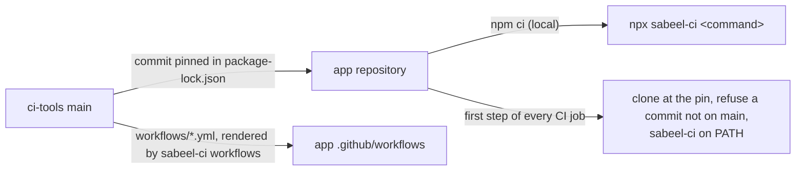

# ci-tools

The CI, release and device-test tooling of the Sabeel Institute apps (LMS,
Kanban, Time Tracker): one copy, which each app pins to a commit. What differs
between the apps is said once, in each app's `ci-tools.json`.



## In an app

```sh
npm install --save-dev github:Sabeel-Institute/ci-tools#<commit>
npx sabeel-ci workflows        # render the shared workflows into .github/workflows/
npx sabeel-ci check-app        # what ci-tools assumes of the app
npx sabeel-ci <command> [args] # any command below
```

`sabeel-ci` runs from anywhere inside the app; each command works at the app's
root, the directory holding `ci-tools.json`.

| Command | What it does |
|---|---|
| `check-app` | The app meets what these tools assume: `ci-tools.json`, the rendered workflows, `.gitignore` covering the files CI writes from secrets, identifiers the premerge fixtures accept, `functions/package-lock.json` in step with its manifest |
| `workflows [--check]` | Render `workflows/*.yml` into `.github/workflows/`, or fail on any difference |
| `ci-platform <task>` | Signed release builds and their provenance: `prepare-android`, `prepare-web`, `android`, `web`, `resolve-build`, `resolve-android-build`, `deploy-config`, `validate-auth` |
| `ci-play verify\|release` | Check a downloaded Play bundle, then check Play access or publish to internal testing |
| `ci-hosting-smoke [--preflight]` | Read-only checks of a Hosting release, before and after publishing |
| `ci-functions require-ci\|plan\|verify` | Guards around a Cloud Functions deploy |
| `ci-premerge <task>` | Pull-request builds with no secrets: `sdk`, `backend`, `prepare`, `android`, `ios` |
| `ci-android-sdk` | The Android SDK packages Gradle needs, with retries |
| `ci-avd` | Boot an emulator on a GitHub runner |
| `check-release <aab>` | Five cold starts of a release bundle on an emulator |
| `check-push [fcm\|apple]` | Against the real project: FCM and both Apple services accept a message from it, and refuse a token that cannot exist with an answer the functions prune on |
| `check-web-push` | The exported web bundle carries a VAPID public key and the permission path; `ci-platform web` runs it on every web build |
| `send-test-push [--apple <development\|production>] <token> [key=value …]` | One real push to one device, opening what the pairs name |
| `install-maestro` | Maestro at a checksum-pinned version; prints its bin directory |
| `ios-sim-build <dir>` | Build the debug app for the iOS simulator and install it |
| `screens-report <shots>` | An HTML report of a screenshot run, diffed against main's last one |

## Push

`check-push` and `send-test-push` build and send through the app's own
functions code, run from source, so a probe or a test push is what a
notification sends. An app provides:

- `functions/src/fcm.ts`: `fcmMessage(message)`, the FCM message less its
  token, and `DEAD_TOKEN_CODES`, the FCM error codes the functions prune on;
- `functions/src/apns.ts`: `sendToApns(sends, credentials)`, each send a
  `{ token, apnsEnvironment, message }`, answering
  `{ delivered, dead, failed }`;
- `functions/src/testPush.ts`: `testMessage(title, body, fields)`, the app's
  message opening what the `key=value` fields name (`{}`: the app), or `null`
  for a destination the app does not open;
- `firebase-admin` installed for `functions/`, one project in `.firebaserc`,
  and `APNS_KEY_ID` and `APPLE_TEAM_ID` in `functions/.env.<project>`.

The three modules import nothing relative except types, so Node runs them as
they are. Apple's key is Secret Manager's `APNS_KEY` for `check-push` and
`~/.apns/AuthKey_<APNS_KEY_ID>.p8` for `send-test-push`, or for either the file
`APNS_KEY_FILE` names; it is never printed. FCM authenticates as Application
Default Credentials, or as `CHECK_ACCESS_TOKEN` when set.

## Changing ci-tools

A change here lands through a pull request merged by the owner, like the apps.
An app picks it up by moving its pin
(`npm install --save-dev github:Sabeel-Institute/ci-tools#<new commit>`),
re-rendering (`npx sabeel-ci workflows`) and passing its own CI. CI refuses a
pin that is not on this repository's `main`.

`CHANGELOG.rst` records what each change means for the apps. `docs/PLAN.md` is
the consolidation still in progress.
