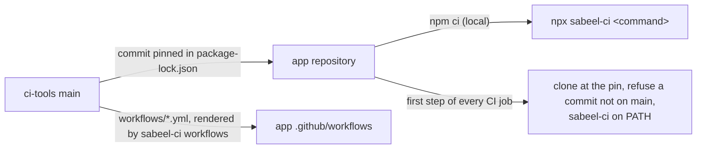

# ci-tools

The CI, release and device-test tooling of the Sabeel Institute apps (LMS,
Kanban, Time Tracker): one copy, which each app pins to a commit. What differs
between the apps is said once, in each app's `ci-tools.json`.



## In an app

```sh
npm install --save-dev github:Sabeel-Institute/ci-tools#<commit>
npx sabeel-ci workflows        # render the shared workflows into .github/workflows/
npx sabeel-ci check-app        # what ci-tools assumes of the app
npx sabeel-ci <command> [args] # any command below
```

`sabeel-ci` runs from anywhere inside the app; each command works at the app's
root, the directory holding `ci-tools.json`.

| Command | What it does |
|---|---|
| `check-app` | The app meets what these tools assume: `ci-tools.json`, the rendered workflows, `.gitignore` covering the files CI writes from secrets, identifiers the premerge fixtures accept, `functions/package-lock.json` in step with its manifest, the emulator ports in `firebase.json` and `app/src/env.ts` and the emulator project in `packages/shared` in step with `ci-tools.json`, no port of the block and no other emulator project stated in `scripts/` or `package.json` |
| `workflows [--check]` | Render `workflows/*.yml` into `.github/workflows/`, or fail on any difference |
| `ci-platform <task>` | Signed release builds and their provenance: `prepare-android`, `prepare-web`, `android`, `web`, `resolve-build`, `resolve-android-build`, `deploy-config`, `validate-auth` |
| `ci-play verify\|release` | Check a downloaded Play bundle, then check Play access or publish to internal testing |
| `ci-hosting-smoke [--preflight]` | Read-only checks of a Hosting release, before and after publishing |
| `ci-functions require-ci\|plan\|verify` | Guards around a Cloud Functions deploy |
| `ci-premerge <task>` | Pull-request builds with no secrets: `sdk`, `backend`, `prepare`, `android`, `ios` |
| `ci-android-sdk` | The Android SDK packages Gradle needs, with retries |
| `ci-avd` | Boot an emulator on a GitHub runner |
| `emulator headless\|window\|list\|shot <name>\|kill [serial]` | This machine's AVD (`tb_emu`, or `SABEEL_AVD`): boot it, without KVM in software; refuses to boot it twice and names who runs it |
| `emulators` | The app's Firebase emulators, left running: ports freed, functions built, inside `emulators.functionsWrapper` |
| `test-emulator` | The functions workspace's emulator suites: `test:emulator:rules` without the Functions emulator, then `test:emulator:functions` with it |
| `free-emulator-ports` | Stop this checkout's leftovers on the app's emulator ports, and the functions runtimes they orphaned |
| `ports [<name>\|--suite]` | The app's ports, one of them, or those an emulator run binds |
| `jdk21` | The home of a JDK 21 or later, for the emulators (`SABEEL_JDK21_HOME`, `~/opt/jdk-21`, `JAVA_HOME`, `java`) |
| `check-release <aab>` | Five cold starts of a release bundle on an emulator |
| `install-maestro` | Maestro at a checksum-pinned version; prints its bin directory |
| `ios-sim-build <dir>` | Build the debug app for the iOS simulator and install it |
| `screens-report <shots>` | An HTML report of a screenshot run, diffed against main's last one |

## Emulator ports

Each app owns a block of 100 ports from `emulators.base` in its
`ci-tools.json` (Time Tracker 61000, Kanban 61200, LMS 61300; 61100 is the
legacy recording app's), and every service sits at the same offset in every
block. `lib/ports.mjs` computes them: `sabeel-ci ports <name>` in shell,
`ports(config(root))` in Node. `check-app` holds `firebase.json` and
`app/src/env.ts`, which cannot read them, in step.

| Offset | Name | Offset | Name |
|---|---|---|---|
| +0 | `firestore` | +7 | `storage` |
| +1 | `firestoreWebsocket` | +8 | `tasks` (Cloud Tasks) |
| +2 | `auth` | +9 | `eventarc` |
| +3 | `functions` | +10 | `web`: the Expo web dev server |
| +4 | `ui` (the Emulator UI) | +11 | `sweep`: a second one, for the screens sweep |
| +5 | `hub` | +12 | `proxy`: a throttling proxy for a device pass |
| +6 | `logging` | +20 to +99 | `emulators.extras`: the app's own, by name |

```json
"emulators": {
  "base": 61300,
  "project": "demo-sabeel-recordings",
  "extras": { "master": 20, "s3": 27 },
  "functionsWrapper": ["node", "scripts/with-media-store.mjs"]
}
```

`project` is the emulators' demo project. `functionsWrapper` is a command
every run with the Functions emulator goes through, taking the run as its
arguments: LMS starts its media store around it.

## Changing ci-tools

A change here lands through a pull request merged by the owner, like the apps.
An app picks it up by moving its pin
(`npm install --save-dev github:Sabeel-Institute/ci-tools#<new commit>`),
re-rendering (`npx sabeel-ci workflows`) and passing its own CI. CI refuses a
pin that is not on this repository's `main`.

`CHANGELOG.rst` records what each change means for the apps. `docs/PLAN.md` is
the consolidation still in progress.
