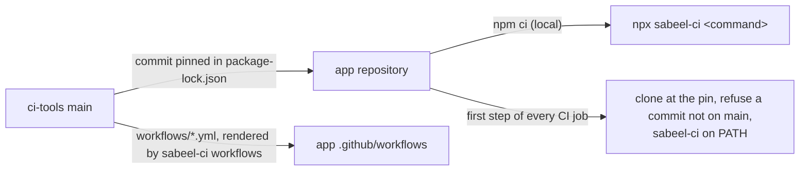
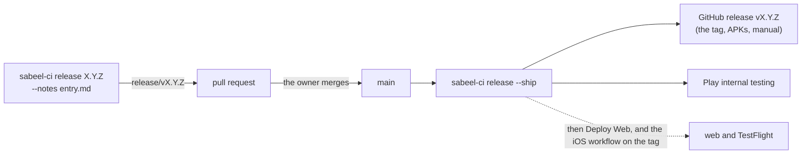

# ci-tools

The CI, release and device-test tooling of the Sabeel Institute apps (LMS,
Kanban, Time Tracker): one copy, which each app pins to a commit. What differs
between the apps is said once, in each app's `ci-tools.json`.



## In an app

```sh
npm install --save-dev github:Sabeel-Institute/ci-tools#<commit>
npx sabeel-ci workflows        # render the shared workflows into .github/workflows/
npx sabeel-ci check-app        # what ci-tools assumes of the app
npx sabeel-ci <command> [args] # any command below
```

`sabeel-ci` runs from anywhere inside the app; each command works at the app's
root, the directory holding `ci-tools.json`.

### Setting up and checking an app

| Command | What it does |
|---|---|
| `check-app` | The app meets what these tools assume: a valid `ci-tools.json`; the rendered workflows unchanged; signing secrets read only inside the `release-build` environment and every release checking its owner first, in the app's own workflows too; `.gitignore` covering the files CI writes from secrets, the build stamp and `functions/.secret.local` (never committed); no `github-actions` entry in the app's `.github/dependabot.yml`; identifiers the pre-merge fixtures accept; the version written only in `app/app.json` (Gradle derives Android's; the iOS build number and the manual's version line agree) and a deploy-log entry for it; the emulator ports and project in `firebase.json`, `app/src/env.ts` and `packages/shared` in step with `ci-tools.json`, and none stated in `scripts/` or `package.json`; `functions/package-lock.json` in step with its manifest; Sentry set up as "Sentry" below says; the Hosting site, `.firebaserc`, the Android manifest's notification channel, the google-services plugin, release signing and the ignored key files, as the app contract under "ci-tools.json" says |
| `workflows [--check]` | Render `workflows/*.yml` into `.github/workflows/`, or fail on any difference |

### Builds and their checks

| Command | What it does |
|---|---|
| `build-info` | Stamp `app/src/build-info.ts` with `app.json`'s version and the commit, `+` when the tree is dirty, for the sign-in label |
| `build-web [--source-maps]` | The web export: version check, stamp, `expo export --clear` into `app/dist-web`, which must carry the stamp |
| `build-aab [--check]` | The signed Play bundle: version check, a deploy-log entry for the version, Sentry set up (the native DSN, the token, `build.gradle`'s `sentry.gradle`), stamp, `gradlew bundleRelease` with `ci-tools.json`'s Sentry org and native project, then no unsigned or debug-signed bundle; `--check` stops before the build |
| `check-version` | `app.json`'s version is store-legal, and Android's versionName and versionCode follow from it |
| `deploy-notes <version> [--title]` | A release's notes, from the deploy log in `docs/PHASE_STATUS.md` |
| `check-text-sources` | No tracked source file holds a control byte that makes tools treat it as binary |
| `preflight-metro` | Refuse to start Metro while another project's Metro holds port 8081 |

### Releases

| Command | What it does |
|---|---|
| `release <X.Y.Z> [--notes <entry.md>] [--dry-run]` | Open the release pull request from origin/main: the version, the iOS build number, the manual (its version line and PDF, through `render-manual`) and the deploy-log entry |
| `render-manual` | `docs/USER-MANUAL.md` to `docs/USER-MANUAL.pdf` with Chrome: a cover with the Sabeel logo (`app/assets/logo.png`), `app.json`'s name less "Sabeel Institute" or "Sabeel", its version and this month; refuses a manual whose "*For app version X.Y.Z · <Month YYYY>*" line names another version. Screenshot pairs are a `<div class="pair">` of a `figure.ph` (phone, first) and a `figure.wd` (computer), images relative to `docs/`. Python (`scripts/lib/render-manual.py`, PEP 723), run with `uv run --script`; needs `uv` and `google-chrome` |
| `release --ship` | On main once the owner has merged it: build, check, tag (the GitHub release, with the APKs and the manual) and publish to Play |
| `publish-play --check\|--internal` | The release bundle to Play internal testing: refuses one not signed with a release key, not HEAD's clean commit or not `app.json`'s version; uploads a draft and completes it only once Play signs the APKs phones install with `release.appSigningCertificate`. `--check` runs the gates and proves the Play permission |
| `check-ios-config` | The iOS configuration that otherwise fails at upload, review or runtime: the plist against `app.json` and the Firebase project, plugins, export compliance, version and build number, icon, the native Sentry DSN, privacy manifest |
| `build-ios [--check]` | On a Mac: every gate (the Sentry token among them), then archive and export a signed App Store `.ipa` to `build/ios/export`, its symbols uploaded to `ci-tools.json`'s native project; never uploads the app. `--check` runs the gates and builds nothing |
| `testflight-check <bundle-id> <version> <build> <commit>` | Before a TestFlight upload: the commit is the one tagged `v<version>` on GitHub, and App Store Connect has not taken the build number |

### In CI

| Command | What it does |
|---|---|
| `ci-platform <task>` | Signed release builds, through `build-aab` and `build-web`, and their provenance: `prepare-android`, `prepare-web`, `prepare-ios`, `asc-key`, `android`, `web` (with its source maps beside the site), `resolve-build`, `resolve-android-build`, `sourcemaps` (Deploy Web's upload to Sentry), `deploy-config`, `validate-auth` |
| `ci-play verify\|release` | Check a downloaded Play bundle, then check Play access or publish to internal testing through `publish-play` |
| `ci-hosting-smoke [--preflight]` | Read-only checks of a Hosting release, before and after publishing |
| `ci-functions require-ci\|plan\|verify` | Guards around a Cloud Functions deploy |
| `ci-premerge <task>` | Pull-request builds with no secrets: `sdk`, `backend`, `prepare`, `android`, `ios` |
| `ci-android-sdk` | The Android SDK packages Gradle needs, with retries |
| `ci-avd` | Boot an emulator on a GitHub runner |
| `screens-report <shots>` | An HTML report of a screenshot run, diffed against main's last one |

### Emulators and devices

| Command | What it does |
|---|---|
| `emulators` | The app's Firebase emulators, left running: ports freed, functions built, inside `emulators.functionsWrapper`. A Functions worker has 120 s to load (`FUNCTIONS_DISCOVERY_TIMEOUT`, unless set), here and in `test-emulator` |
| `emulator-secrets` | Write `functions/.secret.local` from `ci.emulatorSecrets`, for an emulator stack the app starts itself (its browser suites; CI's browser job runs it) |
| `test-emulator` | The functions workspace's emulator suites: `test:emulator:rules` without the Functions emulator, then `test:emulator:functions` with it |
| `free-emulator-ports` | Stop this checkout's leftovers on the app's emulator ports, and the functions runtimes they orphaned |
| `ports [<name>\|--suite\|--project]` | The app's ports, one of them, those an emulator run binds, or the emulators' project (`demo-sabeel-<name>`) |
| `jdk21` | The home of a JDK 21 or later, for the emulators (`SABEEL_JDK21_HOME`, `~/opt/jdk-21`, `JAVA_HOME`, `java`) |
| `emulator headless\|window\|list\|shot <name>\|kill [serial]` | This machine's AVD (`tb_emu`, or `SABEEL_AVD`): boot it, without KVM in software; refuses to boot it twice and names who runs it |
| `check-release <aab>` | Five cold starts of a release bundle on an emulator |
| `native-e2e [--ios] [flow]` | The Maestro flows in `maestro/` against the debug build and the app's emulators, on the one booted Android device or an iPhone simulator; screenshots, Maestro's report and the logs in `shots/native/`. Retries once only for React Native's debug-only `pullTransaction` crash and a lost iOS driver |
| `install-maestro` | Maestro at a checksum-pinned version; prints its bin directory |
| `ios-sim-build <dir>` | Build the debug app for the iOS simulator and install it |

### Push

| Command | What it does |
|---|---|
| `check-push [fcm\|apple]` | Against the real project: FCM and both Apple services accept a message from it, and refuse a token that cannot exist with an answer the functions prune on |
| `check-web-push` | The exported web bundle carries a VAPID public key and the permission path; `ci-platform web` runs it on every web build |
| `send-test-push [--apple <development\|production>] <token> [key=value …]` | One real push to one device, opening what the pairs name |

## ci-tools.json

Every key is checked; an unknown or misspelt one fails every command.

| Key | Meaning |
|---|---|
| `name` | The app's short name: lowercase words joined by hyphens, at most 18 characters. The emulators run under the demo project `demo-sabeel-<name>` |
| `ci.browserSuites` | The npm scripts the CI browser job runs, one runner each; `test:screens` is the sweep, and its `shots/screens/` feeds the screens report |
| `ci.emulatorSecrets` | Each secret the functions bind in the emulators, with its placeholder (`{"SENTRY_DSN": "disabled"}`): `functions/.secret.local`, which `emulators`, `test-emulator` and `emulator-secrets` write, so the app keeps no copy |
| `ci.knip` | Run `npm run knip` in CI |
| `ci.ffmpeg` | ffmpeg on the test runners |
| `ci.mediaStore` | SeaweedFS on the integration and browser runners (`WEED_BIN`) |
| `sentry.org`, `sentry.projects.native`, `.web`, `.functions` | The app's Sentry organization and projects, by slug: Android and iOS upload their source maps and symbols to `native`, Deploy Web the web build's to `web`; the functions report to `functions` ("Sentry" below) |
| `ios.backgroundPlayback` | The app plays with the phone locked: `check-ios-config` requires expo-video's `supportsBackgroundPlayback` |
| `emulators.base`, `.extras`, `.functionsWrapper` | The app's port block, its own extra ports and the command its Functions runs go through ("Emulator ports" below) |
| `native.seedWeb` | The seed (`scripts/seed-emulators.mjs`) drives the web app: a web dev server runs on the app's `web` port for it, its address in `E2E_BASE` |
| `native.reversePorts` | Ports the app reaches on this machine's `127.0.0.1`, which the Android emulator is given (`adb reverse`) |
| `release.appSigningCertificate` | The SHA-256 of the certificate Play signs installed APKs with (Play Console, App integrity), as Play Console prints it |

Every app provides the npm scripts the CI workflow runs: `lint`, `typecheck`,
`test`, `test:emulator`, each of `ci.browserSuites`, and `knip` when
`ci.knip` is set. Browser and device suites write screenshots under `shots/`.
Its Maestro flows name their app `appId: ${APP_ID}`, which `native-e2e` sets
to the build it installed, and `scripts/seed-emulators.mjs` seeds the
emulators for them, run with node from the app's root. Its `.github/dependabot.yml` leaves out
`github-actions`: this repository's Dependabot updates the actions in the
templates, and the app takes them with its next pin.

Its Android build, held by `check-app`:

- `app/android/app/build.gradle` signs releases with the properties file
  `SABEEL_KEYSTORE_PROPERTIES` names, which `ci-platform` sets in CI, and
  stops a release it cannot sign: without a key AGP creates no
  `validateSigningRelease` task and packages the release unsigned. A null
  signing config, the pre-merge build's, passes:

  ```groovy
  gradle.taskGraph.whenReady { graph ->
      def releaseSigning = android.buildTypes.release.signingConfig
      def packagesRelease = graph.allTasks.any { it.project == project && it.name ==~ /^(package|sign)Release(Bundle)?$/ }
      if (packagesRelease && releaseSigning != null && releaseSigning.storeFile == null) {
          throw new GradleException("No release key: …")
      }
  }
  ```
- `app/android/build.gradle` takes the google-services plugin at 4.4.4.
- `AndroidManifest.xml` makes the functions' channel, `PUSH_CHANNEL_ID` in
  `packages/shared/src`, the default: `<meta-data
  android:name="com.google.firebase.messaging.default_notification_channel_id"
  android:value="…"/>`.
- `.gitignore` covers `*.jks`, `*.keystore`, `*service-account*.json` and
  `*firebase-adminsdk*.json` (keep `!app/android/app/debug.keystore`).

Its Hosting site, LMS's shape, held by `check-app`: one site in
`firebase.json`; `X-Frame-Options: DENY`, `Content-Security-Policy:
frame-ancestors 'none'`, `X-Content-Type-Options: nosniff` and
`Referrer-Policy: strict-origin-when-cross-origin` on `!/__/**` and on no other
source (Firebase's `/__/` pages are framed by sign-in); `/_expo/static/**`
and `/assets/**` cached `public, max-age=31536000, immutable`; the
single-page rewrite to `/index.html` from `!/_expo/**` alone, so a missing
chunk is a 404; and a `default` alias in `.firebaserc`.

## Sentry

Every app reports crashes the same way, and every release build refuses to
run without what makes a crash readable. Pull-request builds need none of it.

| What | Where |
|---|---|
| The DSNs | `app/.env.local` (`APP_ENV_LOCAL` in CI): `EXPO_PUBLIC_SENTRY_DSN_NATIVE` for Android and iOS, `EXPO_PUBLIC_SENTRY_DSN_WEB` for the web, read by the app's code under those names only |
| The org and projects | `ci-tools.json`'s `sentry`: public slugs, never in the secrets |
| The auth token | `SENTRY_AUTH_TOKEN` in `app/.env.sentry-build-plugin`, the build machine's gitignored file (`BUILD_ENV` in CI, with the App Store Connect key ids and the Apple team) |

- **Android**: `build.gradle` applies `sentry.gradle` exactly when
  `app/.env.sentry-build-plugin` exists:

  ```groovy
  if (file("$projectRoot/.env.sentry-build-plugin").exists()) {
      apply from: new File(["node", "--print", "require.resolve('@sentry/react-native/package.json')"].execute(null, rootDir).text.trim(), "../sentry.gradle")
  }
  ```

  `build-aab` and `release --ship` run Gradle with `SENTRY_ORG` and
  `SENTRY_PROJECT` from `ci-tools.json`; `sentry.gradle` uploads the bundle's
  source map with the file's token. `ci-platform prepare-android` writes the
  file from `BUILD_ENV`.
- **iOS**: `build-ios` exports the same org and native project, and the
  token from the file (`ci-platform prepare-ios` in CI); Xcode's Sentry phase
  uploads the dSYMs and the source map.
- **Web**: `ci-platform web` exports with source maps, requires every script
  Metro wrote to carry its debug id into the Sentry SDK, and puts the maps
  beside the site in the artifact, never in it. Deploy Web's `sourcemaps`
  job, in `release-build` after the owner check, verifies them against the
  build record and uploads them to `sentry.projects.web` with `sentry-cli`
  2.58.6 (checksum-pinned, no npm install); the site is published only once
  they are in.
- `app/metro.config.js` builds on `getSentryExpoConfig` from
  `@sentry/react-native/metro`, so every bundle carries the debug id its map
  is matched by. `check-app` holds the app to this, the gate and the DSN
  names.

## Push from the app's own code

`check-push` and `send-test-push` build and send through the app's own
functions code, run from source, so a probe or a test push is what a
notification sends. An app provides:

- `functions/src/fcm.ts`: `fcmMessage(message)`, the FCM message less its
  token, and `DEAD_TOKEN_CODES`, the FCM error codes the functions prune on;
- `functions/src/apns.ts`: `sendToApns(sends, credentials)`, each send a
  `{ token, apnsEnvironment, message }`, answering
  `{ delivered, dead, failed }`;
- `functions/src/testPush.ts`: `testMessage(title, body, fields)`, the app's
  message opening what the `key=value` fields name (`{}`: the app), or `null`
  for a destination the app does not open;
- `firebase-admin` installed for `functions/`, one project in `.firebaserc`,
  and `APNS_KEY_ID` and `APPLE_TEAM_ID` in `functions/.env.<project>`.

The three modules import nothing relative except types, so Node runs them as
they are. Apple's key is Secret Manager's `APNS_KEY` for `check-push` and
`~/.apns/AuthKey_<APNS_KEY_ID>.p8` for `send-test-push`, or for either the file
`APNS_KEY_FILE` names; it is never printed. FCM authenticates as Application
Default Credentials, or as `CHECK_ACCESS_TOKEN` when set.

## Builds

Every app builds the same way, so CI runs these commands rather than looking
for an app's own scripts. Each app's `package.json` runs them too:

| Script | Runs |
|---|---|
| `prepare` | `npm run build -w @sabeel/shared && sabeel-ci build-info`, so `app/src/build-info.ts` exists to compile against |
| `web:export` (in `app/`) | `sabeel-ci build-web`, for pre-merge builds and Hosting's predeploy |
| `build:aab` | `sabeel-ci build-aab` |
| `start`, `android` (in `app/`) | `sabeel-ci build-info && sabeel-ci preflight-metro && expo …` |

`ci-platform android` and `ci-platform web` call `build-aab` and `build-web`,
then refuse a bundle or export that does not carry HEAD's commit or marks it
`+`. The deploy log is `docs/PHASE_STATUS.md`, with one entry per release
headed `### <date> — <summary> — v<version>`, written with the version bump.

## Emulator ports

Each app owns a block of 100 ports from `emulators.base` in its
`ci-tools.json` (Time Tracker 61000, Kanban 61200, LMS 61300; 61100 is the
legacy recording app's), and every service sits at the same offset in every
block. `lib/ports.mjs` computes them: `sabeel-ci ports <name>` in shell,
`ports(config(root))` in Node. `check-app` holds `firebase.json` and
`app/src/env.ts`, which cannot read them, in step.

| Offset | Name | Offset | Name |
|---|---|---|---|
| +0 | `firestore` | +7 | `storage` |
| +1 | `firestoreWebsocket` | +8 | `tasks` (Cloud Tasks) |
| +2 | `auth` | +9 | `eventarc` |
| +3 | `functions` | +10 | `web`: the Expo web dev server |
| +4 | `ui` (the Emulator UI) | +11 | `sweep`: a second one, for the screens sweep |
| +5 | `hub` | +12 | `proxy`: a throttling proxy for a device pass |
| +6 | `logging` | +20 to +99 | `emulators.extras`: the app's own, by name |

```json
"emulators": {
  "base": 61300,
  "extras": { "master": 20, "s3": 27 },
  "functionsWrapper": ["node", "scripts/with-media-store.mjs"]
}
```

The emulators' demo project is `demo-sabeel-<name>` (`emulatorProject(config(root))`
from `lib/ports.mjs`, `sabeel-ci ports --project` in shell); `check-app` holds
`EMULATOR_PROJECT_ID` in `packages/shared/src/constants.ts` and the functions'
`functions/.env.demo-sabeel-<name>` to it. `functionsWrapper` is a command
every run with the Functions emulator goes through, taking the run as its
arguments: LMS starts its media store around it.

## Releasing an app

Every app releases the same way. The version is written once, in
`app/app.json`; Android's versionCode and the iOS build number are both
`major * 1000000 + minor * 1000 + patch` (`lib/version.mjs`).



The entry is the version's deploy-log entry in `docs/PHASE_STATUS.md`, heading
first (`### <YYYY-MM-DD> — <summary> — vX.Y.Z`); it titles and describes the
pull request and the GitHub release. `--ship` prints the two workflow runs that
put the same commit on the web and on iPhones.

## Changing ci-tools

A change here lands through a pull request merged by the owner, like the apps.
An app picks it up by moving its pin
(`npm install --save-dev github:Sabeel-Institute/ci-tools#<new commit>`),
re-rendering (`npx sabeel-ci workflows`) and passing its own CI. CI refuses a
pin that is not on this repository's `main`.

`CHANGELOG.rst` records what each change means for the apps. `docs/PLAN.md` is
the consolidation still in progress.
