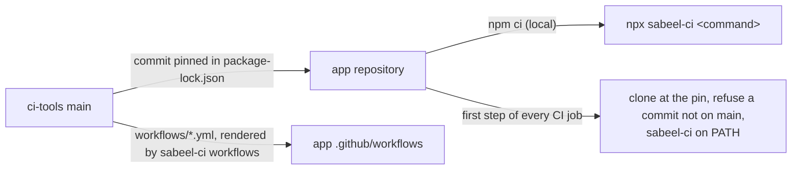
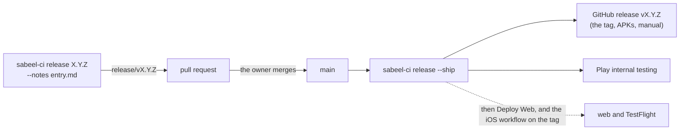

# ci-tools

The CI, release and device-test tooling of the Sabeel Institute apps (LMS,
Kanban, Time Tracker): one copy, which each app pins to a commit. What differs
between the apps is said once, in each app's `ci-tools.json`.



## In an app

```sh
npm install --save-dev github:Sabeel-Institute/ci-tools#<commit>
npx sabeel-ci workflows        # render the shared workflows into .github/workflows/
npx sabeel-ci check-app        # what ci-tools assumes of the app
npx sabeel-ci <command> [args] # any command below
```

`sabeel-ci` runs from anywhere inside the app; each command works at the app's
root, the directory holding `ci-tools.json`.

| Command | What it does |
|---|---|
| `check-app` | The app meets what these tools assume: `ci-tools.json`, the rendered workflows, `.gitignore` covering the files CI writes from secrets, identifiers the premerge fixtures accept, `functions/package-lock.json` in step with its manifest, the version written only in `app/app.json` (Gradle derives Android's; the iOS build number and the manual's version line agree with it) |
| `workflows [--check]` | Render `workflows/*.yml` into `.github/workflows/`, or fail on any difference |
| `ci-platform <task>` | Signed release builds and their provenance: `prepare-android`, `prepare-web`, `android`, `web`, `resolve-build`, `resolve-android-build`, `deploy-config`, `validate-auth` |
| `ci-play verify\|release` | Check a downloaded Play bundle, then check Play access or publish to internal testing through `publish-play` |
| `publish-play --check\|--internal` | The release bundle to Play internal testing: refuses one not signed with a release key, not HEAD's clean commit or not app.json's version; uploads a draft, completes it only once Play signs the APKs phones install with `release.appSigningCertificate`. `--check` runs the gates and proves the Play permission |
| `release <X.Y.Z> [--notes <entry.md>] [--dry-run]` | Open the release pull request: the version, the iOS build number, the manual and the deploy-log entry, from origin/main |
| `release --ship` | On main once the owner has merged it: build, check, tag (the GitHub release, with the APKs and the manual) and publish to Play |
| `ci-hosting-smoke [--preflight]` | Read-only checks of a Hosting release, before and after publishing |
| `ci-functions require-ci\|plan\|verify` | Guards around a Cloud Functions deploy |
| `ci-premerge <task>` | Pull-request builds with no secrets: `sdk`, `backend`, `prepare`, `android`, `ios` |
| `ci-android-sdk` | The Android SDK packages Gradle needs, with retries |
| `ci-avd` | Boot an emulator on a GitHub runner |
| `check-release <aab>` | Five cold starts of a release bundle on an emulator |
| `install-maestro` | Maestro at a checksum-pinned version; prints its bin directory |
| `ios-sim-build <dir>` | Build the debug app for the iOS simulator and install it |
| `screens-report <shots>` | An HTML report of a screenshot run, diffed against main's last one |

## Releasing an app

Every app releases the same way. The version is written once, in
`app/app.json`; Android's versionCode and the iOS build number are both
`major * 1000000 + minor * 1000 + patch` (`lib/version.mjs`).



The entry is the version's deploy-log entry in `docs/PHASE_STATUS.md`, heading
first (`### <YYYY-MM-DD> — <summary> — vX.Y.Z`); it titles and describes the
pull request and the GitHub release. `--ship` prints the two workflow runs that
put the same commit on the web and on iPhones.

## Changing ci-tools

A change here lands through a pull request merged by the owner, like the apps.
An app picks it up by moving its pin
(`npm install --save-dev github:Sabeel-Institute/ci-tools#<new commit>`),
re-rendering (`npx sabeel-ci workflows`) and passing its own CI. CI refuses a
pin that is not on this repository's `main`.

`CHANGELOG.rst` records what each change means for the apps. `docs/PLAN.md` is
the consolidation still in progress.
