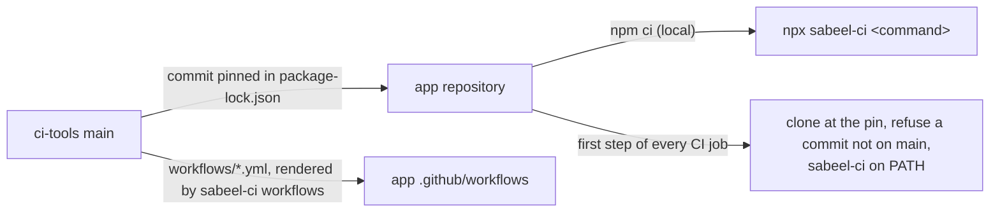

# ci-tools

The CI, release and device-test tooling of the Sabeel Institute apps (LMS,
Kanban, Time Tracker): one copy, which each app pins to a commit. What differs
between the apps is said once, in each app's `ci-tools.json`.



## In an app

```sh
npm install --save-dev github:Sabeel-Institute/ci-tools#<commit>
npx sabeel-ci workflows        # render the shared workflows into .github/workflows/
npx sabeel-ci check-app        # what ci-tools assumes of the app
npx sabeel-ci <command> [args] # any command below
```

`sabeel-ci` runs from anywhere inside the app; each command works at the app's
root, the directory holding `ci-tools.json`.

| Command | What it does |
|---|---|
| `check-app` | The app meets what these tools assume: `ci-tools.json`, the rendered workflows, `.gitignore` covering the files CI writes from secrets and the build stamp, identifiers the premerge fixtures accept, a deploy-log entry for the app's version, `functions/package-lock.json` in step with its manifest |

| `check-app` | The app meets what these tools assume: `ci-tools.json`, the rendered workflows, `.gitignore` covering the files CI writes from secrets, identifiers the premerge fixtures accept, `functions/package-lock.json` in step with its manifest, the emulator ports in `firebase.json` and `app/src/env.ts` and the emulator project in `packages/shared` in step with `ci-tools.json`, no port of the block and no other emulator project stated in `scripts/` or `package.json` |
| `workflows [--check]` | Render `workflows/*.yml` into `.github/workflows/`, or fail on any difference |
| `build-info` | Stamp `app/src/build-info.ts` with `app.json`'s version and the commit, `+` when the tree is dirty, for the sign-in label |
| `build-web [--source-maps]` | The web export: version check, stamp, `expo export --clear` into `app/dist-web`, which must carry the stamp |
| `build-aab [--check]` | The signed Play bundle: version check, a deploy-log entry for the version, the native Sentry DSN in `app/.env.local`, stamp, `gradlew bundleRelease`, then no unsigned or debug-signed bundle; `--check` stops before the build |
| `check-version` | `app.json`'s version is store-legal, and Android's versionName and versionCode follow from it |
| `deploy-notes <version> [--title]` | A release's notes, from the deploy log in `docs/PHASE_STATUS.md` |
| `check-text-sources` | No tracked source file holds a control byte that makes tools treat it as binary |
| `preflight-metro` | Refuse to start Metro while another project's Metro holds port 8081 |
| `ci-platform <task>` | Signed release builds, through `build-aab` and `build-web`, and their provenance: `prepare-android`, `prepare-web`, `android`, `web`, `resolve-build`, `resolve-android-build`, `deploy-config`, `validate-auth` |

| `check-app` | The app meets what these tools assume: `ci-tools.json`, the rendered workflows, `.gitignore` covering the files CI writes from secrets, signing secrets read only inside the `release-build` environment and every release checking its owner first (in the app's own workflows too), identifiers the premerge fixtures accept, `functions/package-lock.json` in step with its manifest |
| `workflows [--check]` | Render `workflows/*.yml` into `.github/workflows/`, or fail on any difference |
| `ci-platform <task>` | Signed release builds and their provenance: `prepare-android`, `prepare-web`, `prepare-ios`, `asc-key`, `android`, `web`, `resolve-build`, `resolve-android-build`, `deploy-config`, `validate-auth` |
| `ci-play verify\|release` | Check a downloaded Play bundle, then check Play access or publish to internal testing |
| `ci-hosting-smoke [--preflight]` | Read-only checks of a Hosting release, before and after publishing |
| `ci-functions require-ci\|plan\|verify` | Guards around a Cloud Functions deploy |
| `ci-premerge <task>` | Pull-request builds with no secrets: `sdk`, `backend`, `prepare`, `android`, `ios` |
| `ci-android-sdk` | The Android SDK packages Gradle needs, with retries |
| `ci-avd` | Boot an emulator on a GitHub runner |
| `emulator headless\|window\|list\|shot <name>\|kill [serial]` | This machine's AVD (`tb_emu`, or `SABEEL_AVD`): boot it, without KVM in software; refuses to boot it twice and names who runs it |
| `emulators` | The app's Firebase emulators, left running: ports freed, functions built, inside `emulators.functionsWrapper` |
| `test-emulator` | The functions workspace's emulator suites: `test:emulator:rules` without the Functions emulator, then `test:emulator:functions` with it |
| `free-emulator-ports` | Stop this checkout's leftovers on the app's emulator ports, and the functions runtimes they orphaned |
| `ports [<name>\|--suite]` | The app's ports, one of them, or those an emulator run binds |
| `jdk21` | The home of a JDK 21 or later, for the emulators (`SABEEL_JDK21_HOME`, `~/opt/jdk-21`, `JAVA_HOME`, `java`) |
| `check-release <aab>` | Five cold starts of a release bundle on an emulator |
| `check-push [fcm\|apple]` | Against the real project: FCM and both Apple services accept a message from it, and refuse a token that cannot exist with an answer the functions prune on |
| `check-web-push` | The exported web bundle carries a VAPID public key and the permission path; `ci-platform web` runs it on every web build |
| `send-test-push [--apple <development\|production>] <token> [key=value …]` | One real push to one device, opening what the pairs name |
| `install-maestro` | Maestro at a checksum-pinned version; prints its bin directory |
| `ios-sim-build <dir>` | Build the debug app for the iOS simulator and install it |
| `check-ios-config` | The iOS configuration that otherwise fails at upload, review or runtime: the plist against `app.json` and the Firebase project, plugins, export compliance, version and build number, icon, Sentry DSN, privacy manifest |
| `build-ios [--check]` | On a Mac: every gate, then archive and export a signed App Store `.ipa` to `build/ios/export`; never uploads. `--check` runs the gates and builds nothing |
| `testflight-check <bundle-id> <version> <build> <commit>` | Before a TestFlight upload: the commit is the one tagged `v<version>` on GitHub, and App Store Connect has not taken the build number |
| `screens-report <shots>` | An HTML report of a screenshot run, diffed against main's last one |

## ci-tools.json

Every key is checked; an unknown or misspelt one fails every command.

| Key | Meaning |
|---|---|
| `name` | The app's short name |
| `ci.browserSuites` | The npm scripts the CI browser job runs, one runner each; `test:screens` is the sweep, and its `shots/screens/` feeds the screens report |
| `ci.emulatorSecrets` | Each secret the functions bind in the emulators, with its placeholder (`{"SENTRY_DSN": "disabled"}`) |
| `ci.knip` | Run `npm run knip` in CI |
| `ci.ffmpeg` | ffmpeg on the test runners |
| `ci.mediaStore` | SeaweedFS on the integration and browser runners (`WEED_BIN`) |
| `build.sentryDsnVariable` | The `app/.env.local` variable carrying the native Sentry DSN; Android and iOS release builds refuse to run without it |
| `ios.backgroundPlayback` | The app plays with the phone locked: `check-ios-config` requires expo-video's `supportsBackgroundPlayback` |

Every app provides the npm scripts the CI workflow runs: `lint`, `typecheck`,
`test`, `test:emulator`, each of `ci.browserSuites`, and `knip` when
`ci.knip` is set. Browser and device suites write screenshots under `shots/`.

## Push

`check-push` and `send-test-push` build and send through the app's own
functions code, run from source, so a probe or a test push is what a
notification sends. An app provides:

- `functions/src/fcm.ts`: `fcmMessage(message)`, the FCM message less its
  token, and `DEAD_TOKEN_CODES`, the FCM error codes the functions prune on;
- `functions/src/apns.ts`: `sendToApns(sends, credentials)`, each send a
  `{ token, apnsEnvironment, message }`, answering
  `{ delivered, dead, failed }`;
- `functions/src/testPush.ts`: `testMessage(title, body, fields)`, the app's
  message opening what the `key=value` fields name (`{}`: the app), or `null`
  for a destination the app does not open;
- `firebase-admin` installed for `functions/`, one project in `.firebaserc`,
  and `APNS_KEY_ID` and `APPLE_TEAM_ID` in `functions/.env.<project>`.

The three modules import nothing relative except types, so Node runs them as
they are. Apple's key is Secret Manager's `APNS_KEY` for `check-push` and
`~/.apns/AuthKey_<APNS_KEY_ID>.p8` for `send-test-push`, or for either the file
`APNS_KEY_FILE` names; it is never printed. FCM authenticates as Application
Default Credentials, or as `CHECK_ACCESS_TOKEN` when set.

## Builds

Every app builds the same way, so CI runs these commands rather than looking
for an app's own scripts. Each app's `package.json` runs them too:

| Script | Runs |
|---|---|
| `prepare` | `npm run build -w @sabeel/shared && sabeel-ci build-info`, so `app/src/build-info.ts` exists to compile against |
| `web:export` (in `app/`) | `sabeel-ci build-web`, for pre-merge builds and Hosting's predeploy |
| `build:aab` | `sabeel-ci build-aab` |
| `start`, `android` (in `app/`) | `sabeel-ci build-info && sabeel-ci preflight-metro && expo …` |

`ci-platform android` and `ci-platform web` call `build-aab` and `build-web`,
then refuse a bundle or export that does not carry HEAD's commit or marks it
`+`. The deploy log is `docs/PHASE_STATUS.md`, with one entry per release
headed `### <date> — <summary> — v<version>`, written with the version bump.

## Emulator ports

Each app owns a block of 100 ports from `emulators.base` in its
`ci-tools.json` (Time Tracker 61000, Kanban 61200, LMS 61300; 61100 is the
legacy recording app's), and every service sits at the same offset in every
block. `lib/ports.mjs` computes them: `sabeel-ci ports <name>` in shell,
`ports(config(root))` in Node. `check-app` holds `firebase.json` and
`app/src/env.ts`, which cannot read them, in step.

| Offset | Name | Offset | Name |
|---|---|---|---|
| +0 | `firestore` | +7 | `storage` |
| +1 | `firestoreWebsocket` | +8 | `tasks` (Cloud Tasks) |
| +2 | `auth` | +9 | `eventarc` |
| +3 | `functions` | +10 | `web`: the Expo web dev server |
| +4 | `ui` (the Emulator UI) | +11 | `sweep`: a second one, for the screens sweep |
| +5 | `hub` | +12 | `proxy`: a throttling proxy for a device pass |
| +6 | `logging` | +20 to +99 | `emulators.extras`: the app's own, by name |

```json
"emulators": {
  "base": 61300,
  "project": "demo-sabeel-recordings",
  "extras": { "master": 20, "s3": 27 },
  "functionsWrapper": ["node", "scripts/with-media-store.mjs"]
}
```

`project` is the emulators' demo project. `functionsWrapper` is a command
every run with the Functions emulator goes through, taking the run as its
arguments: LMS starts its media store around it.

## Changing ci-tools

A change here lands through a pull request merged by the owner, like the apps.
An app picks it up by moving its pin
(`npm install --save-dev github:Sabeel-Institute/ci-tools#<new commit>`),
re-rendering (`npx sabeel-ci workflows`) and passing its own CI. CI refuses a
pin that is not on this repository's `main`.

`CHANGELOG.rst` records what each change means for the apps. `docs/PLAN.md` is
the consolidation still in progress.
