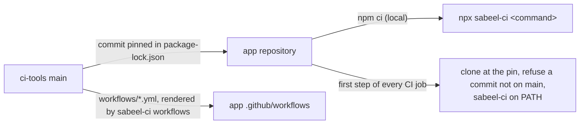

# ci-tools

The CI, release and device-test tooling of the Sabeel Institute apps (LMS,
Kanban, Time Tracker): one copy, which each app pins to a commit. What differs
between the apps is said once, in each app's `ci-tools.json`.



## In an app

```sh
npm install --save-dev github:Sabeel-Institute/ci-tools#<commit>
npx sabeel-ci workflows        # render the shared workflows into .github/workflows/
npx sabeel-ci check-app        # what ci-tools assumes of the app
npx sabeel-ci <command> [args] # any command below
```

`sabeel-ci` runs from anywhere inside the app; each command works at the app's
root, the directory holding `ci-tools.json`.

| Command | What it does |
|---|---|
| `check-app` | The app meets what these tools assume: `ci-tools.json`, the rendered workflows, `.gitignore` covering the files CI writes from secrets, identifiers the premerge fixtures accept, `functions/package-lock.json` in step with its manifest |
| `workflows [--check]` | Render `workflows/*.yml` into `.github/workflows/`, or fail on any difference |
| `ci-platform <task>` | Signed release builds and their provenance: `prepare-android`, `prepare-web`, `android`, `web`, `resolve-build`, `resolve-android-build`, `deploy-config`, `validate-auth` |
| `ci-play verify\|release` | Check a downloaded Play bundle, then check Play access or publish to internal testing |
| `ci-hosting-smoke [--preflight]` | Read-only checks of a Hosting release, before and after publishing |
| `ci-functions require-ci\|plan\|verify` | Guards around a Cloud Functions deploy |
| `ci-premerge <task>` | Pull-request builds with no secrets: `sdk`, `backend`, `prepare`, `android`, `ios` |
| `ci-android-sdk` | The Android SDK packages Gradle needs, with retries |
| `ci-avd` | Boot an emulator on a GitHub runner |
| `check-release <aab>` | Five cold starts of a release bundle on an emulator |
| `install-maestro` | Maestro at a checksum-pinned version; prints its bin directory |
| `ios-sim-build <dir>` | Build the debug app for the iOS simulator and install it |
| `screens-report <shots>` | An HTML report of a screenshot run, diffed against main's last one |

## ci-tools.json

Every key is checked; an unknown or misspelt one fails every command.

| Key | Meaning |
|---|---|
| `name` | The app's short name |
| `ci.browserSuites` | The npm scripts the CI browser job runs, one runner each; `test:screens` is the sweep, and its `shots/screens/` feeds the screens report |
| `ci.emulatorSecrets` | Each secret the functions bind in the emulators, with its placeholder (`{"SENTRY_DSN": "disabled"}`) |
| `ci.knip` | Run `npm run knip` in CI |
| `ci.ffmpeg` | ffmpeg on the test runners |
| `ci.mediaStore` | SeaweedFS on the integration and browser runners (`WEED_BIN`) |

Every app provides the npm scripts the CI workflow runs: `lint`, `typecheck`,
`test`, `test:emulator`, each of `ci.browserSuites`, and `knip` when
`ci.knip` is set. Browser and device suites write screenshots under `shots/`.

## Changing ci-tools

A change here lands through a pull request merged by the owner, like the apps.
An app picks it up by moving its pin
(`npm install --save-dev github:Sabeel-Institute/ci-tools#<new commit>`),
re-rendering (`npx sabeel-ci workflows`) and passing its own CI. CI refuses a
pin that is not on this repository's `main`.

`CHANGELOG.rst` records what each change means for the apps. `docs/PLAN.md` is
the consolidation still in progress.
